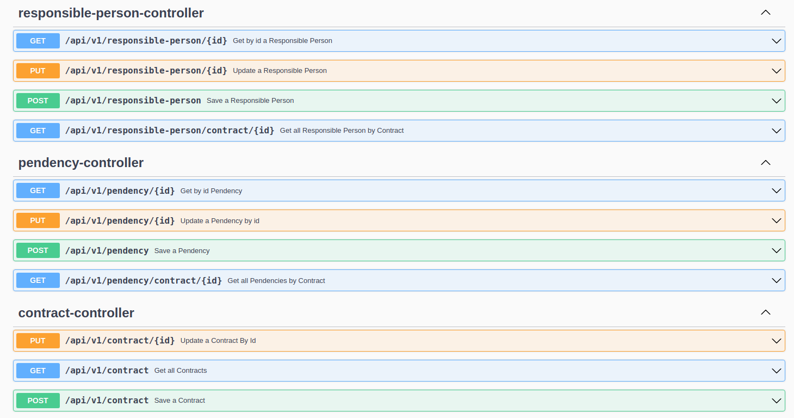
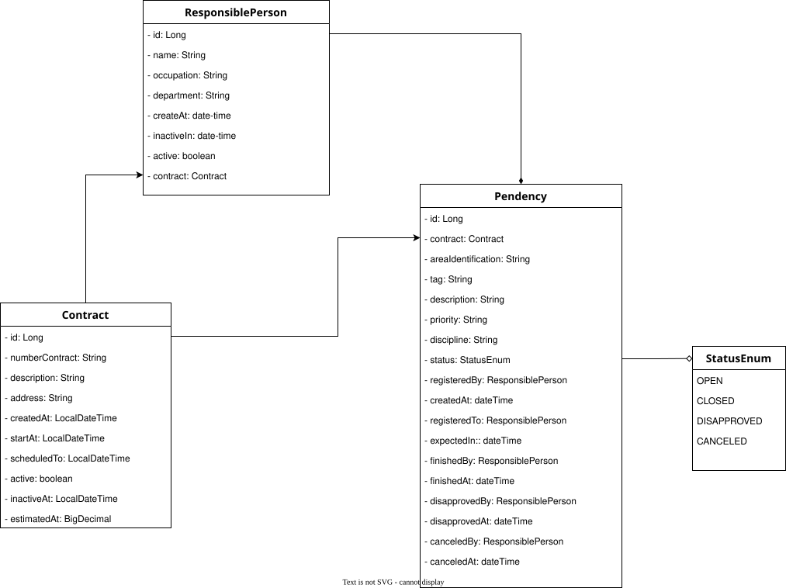

[](https://github.com/djbrunoramon/punch-list-api/actions/workflows/maven.yml)

# Punch List API - Pending Registration

- [Overview](#overview)
- [Tech stack](#tech-stack)
- [Prerequisites](#prerequisites)
- [Running](#running)
- [Tests](#tests)
- [Configuration](#configuration)
- [Architecture](#architecture)
- [API](#api)
- [Swagger, OpenAPI and health](#swagger-openapi-and-health)
- [Database migrations](#database-migrations)
- [Class diagram](#class-diagram)
- [Frontend](#frontend)

## Overview

REST API for registering punch list items (pendencies) of EPC contracts. A contract has responsible people and
pendencies; each pendency has a status (`OPEN`, `CLOSED`, `DISAPPROVED`, `CANCELED`), a priority and a discipline,
and references the responsible people involved. The API also exposes aggregated data for dashboard charts.

_Also access the frontend made in Angular for better use of the backend: [Punch-List APP](https://github.com/djbrunoramon/punch-list-app)_

## Tech stack

* Java 25
* Spring Boot 4.1.2 (Spring MVC, Bean Validation, Actuator)
* Spring Data JPA
* Liquibase (formatted SQL changelogs)
* PostgreSQL 17 (default database)
* H2 in PostgreSQL mode (`h2` profile, no Docker)
* springdoc-openapi 3.2.0
* Testcontainers (PostgreSQL)
* ArchUnit 1.5.1
* Project Lombok
* Maven (Maven Wrapper)

## Prerequisites

* JDK 25
* Docker (PostgreSQL via Docker Compose, and Testcontainers in the tests)

## Running

Default (PostgreSQL started automatically from `compose.yaml` by `spring-boot-docker-compose`):

```bash
./mvnw spring-boot:run
```

Without Docker, with in-memory H2 (the `h2` profile also enables the H2 console at `/h2-console`):

```bash
./mvnw spring-boot:run -Dspring-boot.run.profiles=h2
```

With a Testcontainers PostgreSQL, run the class `TestPunchListApiApplication` (in `src/test`) from your IDE.

The API listens on http://localhost:8080 (override with `PORT`). Demo data is loaded by default (see
[Database migrations](#database-migrations)).

## Tests

```bash
./mvnw verify
```

Runs unit tests, web slice tests (`*WebTest`), ArchUnit rules and the integration tests (`*IT`, Surefire/Failsafe).
Docker must be running: the integration tests use a PostgreSQL Testcontainer.

## Configuration

| Variable | Default | Purpose |
|---|---|---|
| `APP_CORS_ALLOWED_ORIGINS` | `http://localhost:4200` | Allowed browser origins for `/api/**` (comma separated) |
| `SPRING_DATASOURCE_URL` | from Docker Compose in dev | JDBC URL |
| `SPRING_DATASOURCE_USERNAME` | from Docker Compose in dev | Database user |
| `SPRING_DATASOURCE_PASSWORD` | from Docker Compose in dev | Database password |
| `LIQUIBASE_CONTEXTS` | `demo` | Liquibase contexts; set it to another value (for example `prod`) to skip the demo data. An empty value runs every changeset, including the demo data |
| `SPRING_PROFILES_ACTIVE` | none | Spring profiles (for example `h2`) |
| `PORT` | `8080` | HTTP port |

The credentials in `compose.yaml` are for local development only.

## Architecture

Package by feature under `br.com.engbr.examples.punchlistapi`:

```
punchlistapi/
  PunchListApiApplication
  contract/            Contract, ContractRequest, ContractResponse, ContractMapper,
                       ContractRepository, ContractService, ContractController
  responsibleperson/   ResponsiblePerson, ...Request, ...Response, ...Summary, ...Mapper,
                       ...Repository, ...Service, ...Controller
  pendency/            Pendency, PendencyStatus, PendencyStatusValidator, ...Request, ...Response, ...Mapper,
                       ...Repository, ...Service, ...Controller
    chart/             PendencyByStatus, PendencyByPriority
  shared/
    error/             ResourceNotFoundException, BusinessRuleException
    persistence/       BaseEntity
    web/               ApiExceptionHandler, CorsConfig, CorsProperties, OpenApiConfig
```

Architecture rules enforced by ArchUnit (`ArchitectureTest`):

* Controllers do not access repositories.
* Controllers do not expose JPA entities.
* `shared` does not depend on any feature.
* Features are free of dependency cycles.
* No field injection (`@Autowired` on fields).
* Repositories are used only by services (and other repositories).

## API

Base path: `/api/v1`.

| Method | Route | Success | Errors |
|---|---|---|---|
| GET | `/contract` | 200 list of `ContractResponse` | |
| GET | `/contract/{id}` | 200 | 404 |
| POST | `/contract` | 201 + `Location` | 400 |
| PUT | `/contract/{id}` | 200 | 400, 404 |
| GET | `/responsible-person/contract/{contractId}` | 200 page of `ResponsiblePersonResponse` | |
| GET | `/responsible-person/{id}` | 200 | 404 |
| POST | `/responsible-person` | 201 + `Location` | 400, 404 (contract not found) |
| PUT | `/responsible-person/{id}` | 200 | 400, 404 |
| GET | `/pendency/contract/{contractId}` | 200 page of `PendencyResponse` | |
| GET | `/pendency/{id}` | 200 | 404 |
| POST | `/pendency` | 201 + `Location` | 400, 404 (contract or responsible person not found), 422 |
| PUT | `/pendency/{id}` | 200 | 400, 404, 422 |
| GET | `/pendency/contract/{contractId}/chart/pie` | 200 `[{label, quantity}]`, always the four statuses | |
| GET | `/pendency/contract/{contractId}/chart/bar/{status}` | 200 `[{priority, quantity}]` | 400 (invalid status) |

### Pages

Paged endpoints accept `page`, `size` (maximum 100) and `sort`. Default: `size=20`, sorted by `createdAt`
(ascending). The response uses the stable Spring Data format (`serialization-mode=via-dto`):

```json
{
  "content": [ ... ],
  "page": { "size": 20, "number": 0, "totalElements": 3, "totalPages": 1 }
}
```

### Dates

Responses format dates as `yyyy-MM-dd'T'HH:mm` (for example `2026-03-15T14:30`). Requests accept ISO local date-time
(`yyyy-MM-dd'T'HH:mm` or with seconds).

### Errors

Errors are `application/problem+json` (RFC 9457 `ProblemDetail`) with `type`, `title`, `status`, `detail` and
`instance`. Validation errors also carry `errors: [{field, message}]`; the `message` text comes from Bean Validation and follows the JVM locale (for example, Portuguese on a pt-BR JVM), so the example below shows the English text. The `type` is one of
`https://punch-list/errors/{not-found|validation|business-rule|conflict|internal}`.

400 (invalid body):

```json
{
  "type": "https://punch-list/errors/validation",
  "title": "Invalid request",
  "status": 400,
  "detail": "One or more fields are invalid",
  "instance": "/api/v1/contract",
  "errors": [
    { "field": "numberContract", "message": "must not be blank" }
  ]
}
```

404 (unknown id):

```json
{
  "type": "https://punch-list/errors/not-found",
  "title": "Resource not found",
  "status": 404,
  "detail": "Pendency 999 not found",
  "instance": "/api/v1/pendency/999"
}
```

Other statuses: 422 (`business-rule`) for a violated business rule, 409 (`conflict`) for a data integrity violation
with a generic `detail`, and 500 (`internal`) always with `detail: "Unexpected error"`; internal messages are never
exposed.

### Pendency status rules

The status determines which fields are required; otherwise the API answers 422:

| Status | Required fields |
|---|---|
| `OPEN` | `registeredBy`, `registeredTo` |
| `DISAPPROVED` | `disapprovedBy`, `disapprovedAt` |
| `CANCELED` | `canceledBy`, `canceledAt` |
| `CLOSED` | `finishedBy`, `finishedAt` |

Every responsible person referenced by a pendency (`registeredBy`, `registeredTo`, `finishedBy`, `disapprovedBy`,
`canceledBy`) must belong to the same contract as the pendency (`idContract`); otherwise the API answers 422. For the same
reason the contract of an existing responsible person cannot be changed (`PUT` with another `idContract` answers 422).
An unknown contract or responsible person answers 404.

## Swagger, OpenAPI and health

* Swagger UI: http://localhost:8080/swagger-ui/index.html
* OpenAPI JSON: http://localhost:8080/api-docs
* Health: http://localhost:8080/actuator/health (only `health` is exposed, without details)



## Database migrations

The schema is managed only by Liquibase (`spring.jpa.hibernate.ddl-auto=validate`). Changelogs are formatted SQL
files in `src/main/resources/db/changelog/sql`, included in order by `changelog-master.xml`. The demo data
(`0100-demo-data.sql`) runs only with the Liquibase context `demo`, which is the default.

Never edit a changeset that has already been applied: create a new file and include it in the master changelog.

## Class diagram

The diagram reflects the data model (tables and relationships).



## Frontend

The Angular frontend lives in [punch-list-app](https://github.com/djbrunoramon/punch-list-app).
